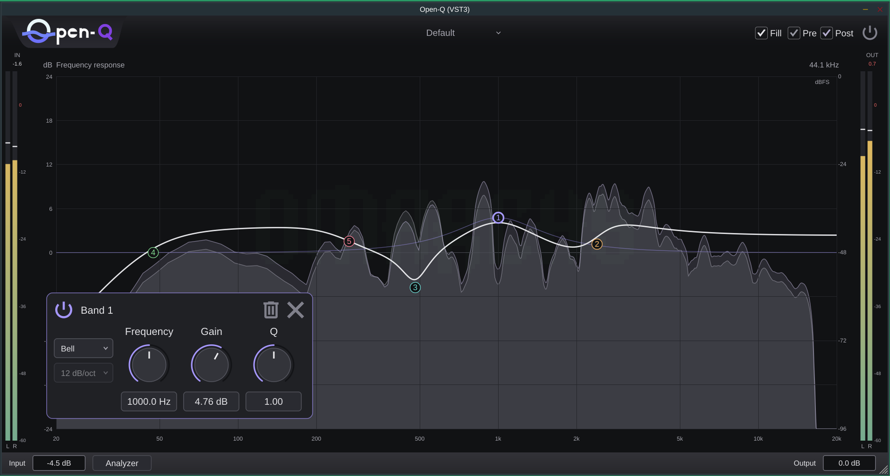

# Open-Q

A free, open-source parametric equalizer for **Windows, macOS and Linux**, built with JUCE. Made by **Yohan Senanayake**.

[**Downloads & previews**](https://github.com/Yohansenanayake/Open-Q/releases) · [Report a bug](https://github.com/Yohansenanayake/Open-Q/issues) · [Build from source](docs/development.md)

## Features

- **24 EQ bands** with bell, low/high shelf and low/high cut filters.
- **Cut slopes from 6 to 96 dB/octave**, including 18 dB/octave.
- **Interactive response graph** with draggable, individually coloured bands and floating controls.
- **Pre/post spectrum analyzer** with Normal/High quality, ERB/octave smoothing and adjustable decay.
- **Input/output gain and peak meters**, per-band bypass and smooth global bypass.
- **Preset browser** with groups and search, DAW automation and session recall.
- **Resizable interface** and mono/stereo processing with no added audio latency.

Double-click the graph to add a band, drag its node to shape the response, and click a node to open its controls.

Open-Q is in active development. Preview builds are available for testing and feedback; features and saved-session compatibility may change between early versions.

## Download

Get versioned packages from [GitHub Releases](https://github.com/Yohansenanayake/Open-Q/releases). Preview builds are marked **Pre-release**; keep the version number when reporting issues.

| Platform | Formats | Package |
| --- | --- | --- |
| Windows | VST3, CLAP, Standalone | Installer |
| macOS | VST3, CLAP, AU, Standalone | ZIP |
| Linux | VST3, CLAP, Standalone | ZIP |

Choose the architecture matching your DAW. Standard x86-64 is the safest choice if you are unsure about AVX2; ARM64 builds are provided separately.

## Installation

- **Windows:** run the installer and select the formats you want.
- **macOS:** extract the ZIP. Copy plugin bundles into the appropriate `VST3`, `Components` or `CLAP` folders under `~/Library/Audio/Plug-Ins/`; copy the standalone app to Applications.
- **Linux:** extract the ZIP. Copy VST3 bundles into `~/.vst3/` and CLAP plugins into `~/.clap/`, or your DAW's configured plugin folders.

Restart your DAW or rescan plugins after installation. Downloads are not yet publisher-signed/notarized, so Windows/macOS may show security warnings. Each release includes `SHA256SUMS.txt` for download verification.

## Contributing

Bug reports, listening feedback and focused pull requests are welcome. For bugs, include the full download version, OS, CPU architecture, DAW and steps to reproduce.

See [development instructions](docs/development.md) for building, tests and debugging, and the [release guide](docs/releasing.md) for CI and distribution.

## Credits and license

Open-Q builds on [ZL Equalizer](https://github.com/ZL-Audio/ZLEqualizer) and [ZL Spectrum Equalizer](https://github.com/ZL-Audio/ZLSpectrumEqualizer), with Ivantsov-based filter designs and adapted UI/analyzer components. Thanks also to [JUCE](https://github.com/juce-framework/JUCE), [Pamplejuce](https://github.com/sudara/pamplejuce), and [Grisey](https://github.com/ZhiyuAlexZhang/Grisey). Origins, revisions and third-party licenses are recorded in [THIRD_PARTY_NOTICES.md](THIRD_PARTY_NOTICES.md).

Source code is licensed under **[AGPL-3.0-only](LICENSE)**. Third-party components retain their original licenses, including the GPL-3.0-only Grisey-derived helper. **The Open-Q logo is excluded from AGPL coverage**; copyright © 2026 Yohan Senanayake, all rights reserved. See the [logo notice](licenses/OpenQ-Logo.txt).
